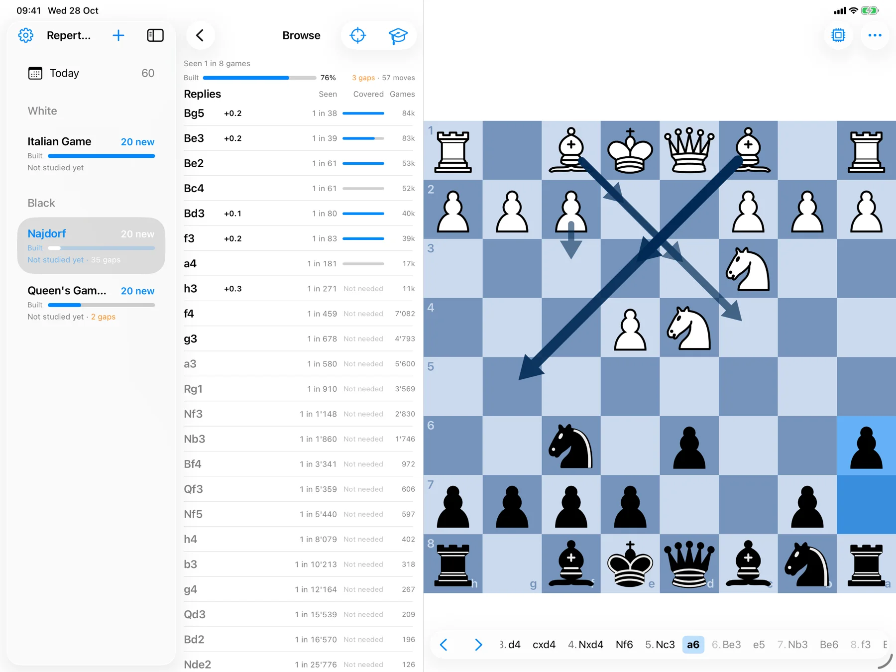
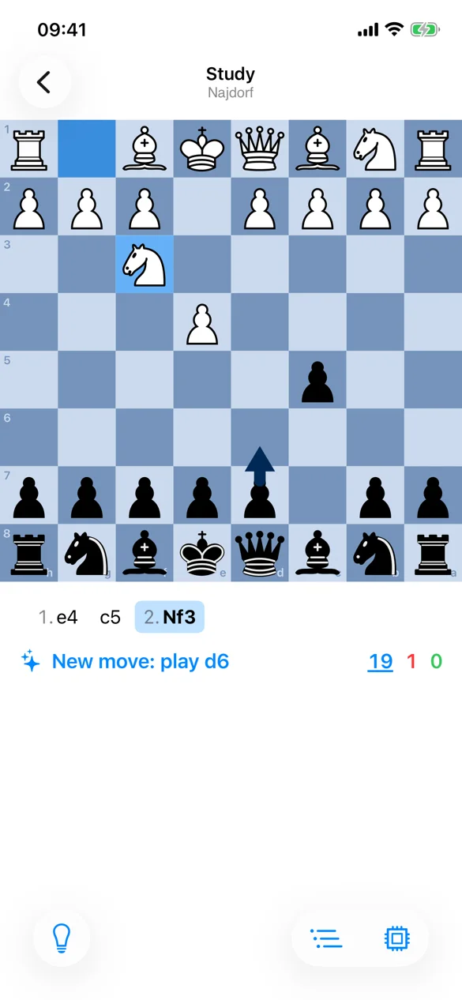

# ORBT Chess

ORBT (said "orbit": Opening Repertoire Builder & Trainer) is a free, open-source opening
repertoire trainer for iPhone, iPad and Mac: no subscription, no ads, no account.
[orbtchess.org](https://orbtchess.org)

<p align="center">
  <picture>
    <source media="(prefers-color-scheme: dark)" srcset="website/public/assets/screens/ipad-build-dark.webp">
    
  </picture>
  <picture>
    <source media="(prefers-color-scheme: dark)" srcset="website/public/assets/screens/iphone-study-dark.webp">
    
  </picture>
</p>

- **Build.** Every move shows how often it's played, how it scores and the engine's
  evaluation, from the Lichess opening explorer. Enter the lines from a book or video, or pick
  moves with the numbers. Transpositions are recognised: a position's lines are stored once.
- **Find the gaps.** Set a target such as "every move played once in 500 games", and ORBT
  lists each opponent move above it that you have no answer for, how often you'd meet it, and
  how complete each line is. Prepare against Lichess blitz or rapid players by rating, or
  over-the-board classical games; their statistics download once, then coverage works offline.
- **Analyse.** One tap opens the position on an analysis board with the moves that led there:
  Lichess's cloud evaluation when there is one, otherwise Stockfish 19 on the device. Bring a
  line back to the repertoire in one tap.
- **Study.** Each position where it's your move is a card, scheduled with Anki's scheduler
  (learning steps, FSRS, daily limits). Study everything that's due, or drill one branch.
  Works offline.
- **Your files.** A repertoire is a plain PGN in iCloud Drive (Files › ORBT Chess), saved on
  every edit and merged across devices. Import any PGN.

## How coverage is computed
For each position, *reach* is the probability of getting there: your own moves count as
1, and each opponent move multiplies by its share of games in the explorer. An opponent
reply is *required* when its reach is at least 1/N (your target) and the position has
enough games. A gap is a required reply you have no line for, or a position where it's
your move and you have none. Completion is the frequency-weighted share of required
replies that are covered, recursively.

Results are cached per node. Editing a line only recomputes that line's subtree and its
ancestors. Statistics are cached by position (FEN without move counters), so each position
is fetched once, and the offline coverage tables answer the common positions without a
request.

## Layout
- `core/`: the Rust core shared by every platform (chess, PGN, repertoire, coverage,
  training, the analysis board and the engine). `orbt-core` has no IO or platform APIs;
  `orbt-ffi` exposes it to Swift and Kotlin with UniFFI.
- `apple/`: the iPhone, iPad and Mac app (SwiftUI, one multiplatform target) and its Swift
  package over the core.
- `android/`: the Android, Windows and Linux app (Compose Multiplatform).
- `website/`: orbtchess.org.
- `Design/`: the app icon, colors and App Store material.
- `docs/PLATFORMS.md`: why native apps only, where each platform keeps the repertoires, and how
  Google Drive and Dropbox sync.

`AGENTS.md` (and one each in `core/`, `apple/` and `android/`) describes the design in
detail: the rules, where each one lives, and the conventions.

## Building
Requires Xcode 26 (iOS 26, macOS 26) and rustup (`brew install rustup`); the pinned toolchain
in `core/rust-toolchain.toml` installs itself on first use.

```
core/scripts/build-apple.sh
xcodebuild -project apple/ORBT.xcodeproj -scheme ORBT -destination 'platform=iOS Simulator,name=iPhone 17 Pro' build
```

`build-apple.sh` builds the core for iOS, the iOS simulator and macOS and regenerates the
Swift bindings; run it again after changing Rust code. For the Mac, use
`-destination 'platform=macOS'`, which needs a development profile for the iCloud
entitlement, or add `CODE_SIGNING_ALLOWED=NO` to compile only.

Before committing Rust changes, `core/scripts/check.sh` runs fmt, clippy, the tests, a wasm32
build and cargo-deny (`cargo install --locked cargo-deny` once).

Once per clone, `git config core.hooksPath core/scripts/git-hooks` turns on hooks that rebuild
the xcframework (not committed) when a pull, merge, rebase or branch switch changes the core.

Lichess sign-in uses OAuth with PKCE and needs no client registration.

## Contributing
Bug reports and ideas are welcome in [GitHub issues](https://github.com/carlvonburg/orbt-chess/issues).
For security problems, see [SECURITY.md](SECURITY.md).

## License
AGPL-3.0-or-later (`LICENSE`). ORBT builds on:
- [Anki](https://github.com/ankitects/anki)'s scheduler, ported to Rust (AGPL-3.0, Ankitects
  Pty Ltd and contributors), and [fsrs-rs](https://github.com/open-spaced-repetition/fsrs-rs)
  (BSD-3-Clause, Open Spaced Repetition)
- [Stockfish](https://stockfishchess.org) (GPL-3.0), built from lichess's
  [multistockfish](https://github.com/lichess-org/dart-multistockfish)
- [shakmaty](https://github.com/niklasf/shakmaty) for the chess rules (GPL-3.0-or-later)
- the "cburnett" piece set (GPL-2.0-or-later), via Lichess
- [Lichess](https://lichess.org)'s opening explorer, cloud evaluations and CC0 game database
- [Lumbra's Gigabase](https://lumbrasgigabase.com) for the over-the-board statistics (CC BY-NC
  4.0; ORBT reduces its games since 2000 to the move counts of its coverage tables)

ORBT is an independent project, not affiliated with Lichess, Anki or Stockfish.
